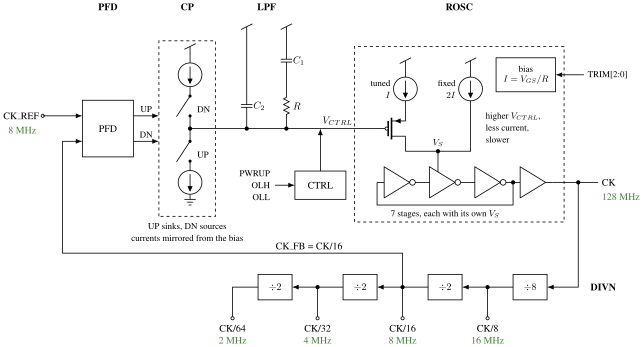

[](../../actions/workflows/gds.yaml)
[](../../actions/workflows/drc.yaml)
[](../../actions/workflows/lvs.yaml)
[](../../actions/workflows/docs.yaml)

# Who

Carsten Wulff

# Why

A PLL for the REY libraries (sky130A, rey_tr/rey_atr cells), the
successor of [sun_pll_sky130nm](https://github.com/wulffern/sun_pll_sky130nm).
sun_pll used a VDD controlled ring oscillator behind an OTA buffer, with a
Kvco of about 1.6 GHz/V, and did not work in the slow corner. REY_PLL
replaces it with a current starved ring oscillator
([osc_ring_adv](https://analogicus.com/aic2027/assets/media/osc_ring_adv_tikz.svg)):
the bias sets the frequency, VCTRL only trims it, and there is no OTA buffer.

It was made in five days by a human and an AI agent. The story, with
every prompt, is in [How It Was Made](documents/howitwasmade.md).

The goal was 512 MHz from an 8 MHz reference (N = 64), working over process,
1.7 to 1.9 V and -40 to 125 C with one trim code per die, and small enough
for a Tiny Tapeout tile. As laid out it locks at 128 MHz (N = 16): with its
wiring the oscillator is too slow for 512 MHz, see below.

# How

Status: the whole PLL is designed and laid out. The core, REY_PLL, is
156.96 x 106.94 um, and the Tiny Tapeout wrapper `tt_um_rey_pll_wulffern`
is one 161 x 111.52 um tile. Both are DRC (magic and KLayout) and LVS clean,
the wrapper also in the antenna check.

**The loop is closed at 128 MHz, not 512.** With the layout's wiring the
oscillator reaches only 211 to 371 MHz over the trim codes (typical) and
146 to 189 MHz in the slow corner, so the feedback is CK/16 (N = 16) and
the oscillator is as it was. The extracted layout locks at 128 MHz in
typical and in all 20 corners (five processes, -40 and 125 C, 1.7 and
1.9 V), each process at one trim code: VCTRL 0.56 to 1.53 V, ripple under
14 mV. The loop filter was sized for N = 64 and has not been retuned: by
hand calculation the phase margin at N = 16 is 20 to 38 degrees. The
numbers are in [sim/REY_PLL/README.md](sim/REY_PLL/README.md) and
[plans/HANDOFF.md](plans/HANDOFF.md).

Every schematic of the design has a short description in
`design/REY_PLL_SKY130A/<cell>.md`. The documentation pages built from
`info.yaml` show them with the schematics.

## REY_PLL

    CK_REF -> PFD -> CP -> LPF -> VCTRL -> ROSC -> DIVN -> CK_FB



The phase frequency detector compares CK_REF with CK_FB, and the charge
pump turns UP and DN into a current on the loop filter. The filter's
voltage, VCTRL, sits on the gate of the device that steers the tuned branch
of each oscillator stage: a higher VCTRL gives less current and a slower
ring, which is why UP sinks and DN sources. CK_FB is CK/16, so CK settles
at 16 x 8 MHz = 128 MHz. The figure is drawn with
[cictikz](https://github.com/wulffern/cictikz) from
[media/rey_pll_how.tex](media/rey_pll_how.tex).

| Block        | What                                                           |
|:-------------|:---------------------------------------------------------------|
| REY_PLL_ROSC | current starved ring oscillator with its Vgs/R bias, see below |
| REY_PLL_PFD  | tri-state phase frequency detector, two reset flops            |
| REY_PLL_CP   | charge pump biased from the oscillator's VBP (1.1 to 2.8 uA over the trim codes). UP sinks and DN sources, since Kvco is negative |
| REY_PLL_LPF  | eight REYPLL_RCU cells: R = 32 x 15.3 kOhm, C1 = 7 MiM, C2 = 1 MiM, both to VDD_1V8 |
| REY_PLL_DIVN | six flop ripple divider. CK/16 is the feedback, CK/8 to CK/64 are buffered to the pins |
| REY_PLL_CTRL | power up, the start-up kick on the loop filter, and the open loop modes |

Powered down (PWRUP_1V8 low) VCTRL is parked at VDD_1V8, the oscillator's
slowest. OLH holds it there with the PLL powered and OLL pulls it to VSS,
the fastest, so the divider taps give the oscillator's range at a trim
code without the loop.

Everything but the oscillator is generated by [py/gen_pll.py](py/gen_pll.py):
the xschem schematics, the subcircuits in `cic/pll.spi` and the routes of
the digital blocks in `cic/pll.json`. Do not edit those by hand:

```bash
python3 py/gen_pll.py design/REY_PLL_SKY130A
```

## Layout

The layout is made with [cicpy](https://github.com/wulffern/cicpy)
sidecars, `design/REY_PLL_SKY130A/<CELL>.py`, one per analog block and one
for the top. Blocks are laid out, routed and checked one by one, and the
level over them places them and routes only between them.
[plans/LAYOUT.md](plans/LAYOUT.md) has the floorplan and the sizes.

```bash
cd work
make cic                       # the unit cells and the digital blocks
make mag CELL=REY_PLL          # about 5 min
make drc CELL=REY_PLL
make gds cdl lvs CELL=REY_PLL
make kdrc CELL=REY_PLL
```

## Tiny Tapeout wrapper

`tt_um_rey_pll_wulffern` (layout and schematic) is generated by
[py/gen_tt_um.py](py/gen_tt_um.py) from the tile's DEF and the core's
ports: power rails, routes to the pads, antenna diodes on the inputs and
tie-low resistors on the unused outputs.

```bash
python3 py/gen_tt_um.py design/REY_PLL_SKY130A
cd work && make drc gds cdl lvs kdrc ant CELL=tt_um_rey_pll_wulffern
```

| TT pin       | Signal    | Description                                       |
|:-------------|:----------|:--------------------------------------------------|
| clk          | CK_REF    | 8 MHz reference                                   |
| ui_in[0]     | PWRUP_1V8 | Power up                                          |
| ui_in[3:1]   | TRIM[2:0] | Bias trim, higher code gives a higher frequency   |
| ui_in[4]     | OLH       | Open loop, VCTRL to VDD_1V8 (slowest)             |
| ui_in[5]     | OLL       | Open loop, VCTRL to VSS (fastest)                 |
| uo_out[3:0]  | CKO[3:0]  | CK/8, CK/16, CK/32, CK/64 (16, 8, 4, 2 MHz at lock) |
| uo_out[7:4], uio_out, uio_oe | | Tied low                                    |
| VDPWR, VGND  | VDD_1V8, VSS | 1.8 V supply                                   |

The 128 MHz clock itself has no pad. uo_out[1] is the feedback clock.

## REY_PLL_ROSC

The schematic is generated by [py/gen_rosc.py](py/gen_rosc.py), do not edit
`REY_PLL_ROSC.sch` by hand:

```bash
python3 py/gen_rosc.py design/REY_PLL_SKY130A
```

Settings are environment variables (`NSTAGE`, `BIAS`, `ND`, `NF`, `NT`, ...),
see the top of the script.

**Ring.** Seven inverter stages (a prime number, 5 also works), each made of
REYATR_PCH_2C1F2 / REYATR_NCH_2C1F2 (L = 0.22 um). The PMOS bulks sit on
VDD_1V8 so all the PMOS share one n-well. The inverters in REYTR_IVX1 were
too fast, and the 5F0 (L = 0.94 um) devices too slow (below 100 MHz with seven
stages).

**Starved supply.** Each stage has its own supply node VS<k>, fed from two
PMOS mirror branches gated by VBP:

- a fixed branch, two LVT_PCH_8C5F0 units straight into VS<k>, which sets the
  lowest frequency and keeps the ring running at any VCTRL
- a tunable branch, one unit into NC<k>, steered into VS<k> by an
  LVT_PCH_4C5F0 with its gate on VCTRL

The frequency falls as VCTRL rises (negative Kvco). The loop will swap UP and
DN at the charge pump, and the loop filter is referenced to VDD_1V8, so supply
noise moves VCTRL together with the PMOS sources.

**Bias, a Vgs/R current source.** With an ideal constant current the ring runs
20 to 50 % faster hot than cold, because its swing follows the thresholds.
Constant current, and the constant-gm bias that was tried first, therefore
drift with temperature. A threshold referenced bias, I = Vgs(MN1)/R, falls
with temperature the same way, so f ~ 1/(R C), and one trim code then holds
over temperature.

- MN1 (NCH_2C5F0) has its gate on VG, and R runs from VG to VSS
- MN2 (4 x LVT_NCH_2C5F0) is a follower from VX to VG that closes the loop.
  LVT keeps VX low enough for the PMOS mirror into MN1 (MPB) to stay in
  saturation
- MP0/MPB, 4 + 4 LVT_PCH_8C5F0 units, are the diode on VBP and the mirror
  into MN1
- startup: MS1/MS2 is an inverter on VG. While VG is low, MS3 pulls VBP down
  and returns that current into VG, through R, so it lifts VG until the
  startup switches itself off. Returned to VSS instead, the bias latched in a
  high current state

**Trim.** R is a ladder from VG to VSS: a fixed 38.5 kOhm (one RPPO4 and two
RPPO2 in parallel), then 7.7, 15.4 and 30.8 kOhm sections, each shorted by
NCH_4C1F2 switches on TRIM0..TRIM2. A higher code means less R, more current
and a higher frequency.

**Output.** An IVX1 then an IVX4 on VDD_1V8, from the last ring node to CK.
The ring swings rail to rail with about 50 % duty cycle.

## Loop filter

[py/pll.py](py/pll.py) designs the loop filter for a crossover (fref/20) and a
phase margin (60 degrees), checks the result numerically, and estimates the
area against a Tiny Tapeout tile:

```bash
python3 py/pll.py --kvco 235e6 --icp 1e-6
python3 py/pll.py --log sim/REY_PLL_ROSC/output_tran/tran_SchGtKttTtVt.log --code 3
```

The capacitance scales with Icp x Kvco and R with its inverse, so the area
has a minimum where the two are about equal, near Icp x Kvco = 0.25 to
1 uA GHz/V. At Icp = 1 uA, |Kvco| = 235 MHz/V and N = 32 it gives C1 = 4 pF,
C2 = 0.31 pF and R = 369 kOhm, about 14 % of a tile with MOS caps. The same
procedure applied to sun_pll's numbers needs 27 pF.

# What

| What                     | Cell/Name                                     |
|:-------------------------|:----------------------------------------------|
| PLL, the core            | design/REY_PLL_SKY130A/REY_PLL.sch, .mag, .py |
| Tiny Tapeout tile        | design/REY_PLL_SKY130A/tt_um_rey_pll_wulffern.sch, .mag |
| Loop generator           | py/gen_pll.py                                 |
| Wrapper generator        | py/gen_tt_um.py                               |
| Lock testbench           | sim/REY_PLL/tran.spi                          |
| Handoff notes            | plans/HANDOFF.md                              |
| Oscillator schematic     | design/REY_PLL_SKY130A/REY_PLL_ROSC.sch       |
| Oscillator generator     | py/gen_rosc.py                                |
| Ring, ideal bias current | design/REY_PLL_SKY130A/REY_PLL_ROSC_IEXT.sch  |
| Loop filter model        | py/pll.py                                     |
| Oscillator testbench     | sim/REY_PLL_ROSC/tran.spi                     |
| Startup testbench        | sim/REY_PLL_ROSC/startup.spi                  |
| Ring only testbench      | sim/REY_PLL_ROSC/iext.spi                     |
| Loop filter unit cells   | cic/lpf.json, design/REY_PLL_SKY130A/REYPLL_RCU.mag |
| Layout plan              | plans/LAYOUT.md                               |

# Simulation

The oscillator on its own, schematic, swept for the original 512 MHz
target (see also [sim/REY_PLL_ROSC/README.md](sim/REY_PLL_ROSC/README.md)):

```bash
cd sim/REY_PLL_ROSC
make netlist
cicsim run --name Sch_etc --threads 8 tran Sch Gt "Ktt,Kss,Kff,Ksf,Kfs" "Tl,Tt,Th" "Vl,Vt,Vh"
python3 trim.py 512 output_tran/tran_SchGt*.log
```

`tran.spi` sweeps every trim code against VCTRL = 0, 0.6, 1.2 and 1.8 V.
VCTRL is set relative to VDD_1V8, so the top of the sweep is the supply in
every corner. The frequency is measured over 10 periods after 100 ns, because
the first ~20 ns are the start-up transient. Frequencies below 100 MHz are not
measured. `trim.py` prints, for each corner, the range per code and the codes
whose VCTRL range contains the target.

Results, schematic, all 45 corners (process Ktt/Kss/Kff/Ksf/Kfs, -40/27/125 C,
1.7/1.8/1.9 V). For every process there is ONE trim code that reaches 512 MHz
inside the VCTRL range at every temperature and supply:

| Process | Codes that work over all T and V |
|:-------:|:--------------------------------:|
| Ktt     | 1..6                             |
| Kss     | 4..7                             |
| Kff     | 0..1                             |
| Ksf     | 3..5                             |
| Kfs     | 0..7                             |

At VCTRL = 0 the frequency is almost flat over temperature (Ktt, code 3 of
the previous 46 kOhm variant: 555 / 565 / 571 MHz at -40 / 27 / 125 C).
The startup turns off in every corner (XST at most 20 mV), and `startup.spi`
starts the bias from a 10 us and a 100 ns supply ramp at codes 0 and 7 in
the five extreme corners. Open: the MPB mirror has only 39 mV of headroom at
Kfs, -40 C, 1.7 V.

## REY_PLL lock

```bash
cd sim/REY_PLL
cicsim run --name Lay_typical tran Lay Gt C3 Ktt Tt Vt   # extracted, 16 us
./corners.sh Lay      # extracted, 20 corners, each process at its trim code
./corners.sh          # the same on the schematic (cannot lock at N = 16)
```

`tran.spi` powers up at 200 ns and measures the frequency of CK (200
periods) and CK_FB (8 periods) and the VCTRL ripple over the last 2 us.
Typical corner, trim code 3:

| View      | N  | CK        | CK_FB     | VCTRL   |                          |
|:----------|:--:|:----------|:----------|:--------|:-------------------------|
| Schematic | 64 | 512.0 MHz | 8.000 MHz | 0.952 V | locks, ripple 8.5 mV     |
| Extracted | 64 | 264.9 MHz | 4.139 MHz | 0 V     | no lock, VCTRL at VSS    |
| Extracted | 16 | 128.0 MHz | 8.001 MHz | 1.077 V | locks, ripple 12.6 mV    |

The layout is the N = 16 one. The schematic view cannot lock at N = 16:
without the wiring the oscillator's slowest is 274 MHz. At N = 16 the
extracted view also locks in all 20 corners: Ktt, Kss, Kff, Ksf and Kfs at
-40 and 125 C, 1.7 and 1.9 V, with trim codes 3, 6, 0, 4 and 3. CK is
127.99 to 128.01 MHz, VCTRL 0.56 to 1.53 V and the ripple 8 to 13 mV. The
table of every corner is in [sim/REY_PLL/README.md](sim/REY_PLL/README.md).
The trim codes are the ones from the schematic sweep above. The sweep has
not been repeated on the extracted oscillator for 128 MHz.

The oscillator alone, CK at VCTRL = 0 (its fastest), typical:

| Trim code | Schematic, MHz | Extracted, MHz |
|:---------:|:--------------:|:--------------:|
| 0         | 509            | 211            |
| 1         | 545            | 226            |
| 2         | 589            | 245            |
| 3         | 638            | 265            |
| 4         | 704            | 291            |
| 5         | 775            | 318            |
| 6         | 862            | 346            |
| 7         | 953            | 371            |

The extraction (capacitance only) puts about 10 fF of wiring on each ring
node, more than the devices' own load. See
[plans/HANDOFF.md](plans/HANDOFF.md).

## Loop filter cells

The loop filter is built from REYPLL_RCU, a unit cell with a REYPLL_HRPPO8
(4 x 15.3 kOhm) and a 473 fF MiM stacked on top in 16 x 20.8 um, compiled from
[cic/lpf.json](cic/lpf.json) with cicpy (`cd work && make cic`). DRC clean,
LVS matches. At Icp = 1.6 uA the filter is 8 cells, 15 % of a tile, see
[plans/LAYOUT.md](plans/LAYOUT.md).

# Signal interface (REY_PLL_ROSC)

| Signal      | Direction | Domain  | Description                                        |
|:------------|:---------:|:-------:|:---------------------------------------------------|
| VDD_1V8     | Input     | VDD_1V8 | Supply                                             |
| VSS         | Input     | Ground  |                                                    |
| TRIM0..2    | Input     | VDD_1V8 | Bias trim, higher code gives a higher frequency    |
| VCTRL       | Input     | VDD_1V8 | Frequency control, f falls as VCTRL rises          |
| CK          | Output    | VDD_1V8 | Oscillator output                                  |

# Key parameters

| Parameter           | Min     | Typ             | Max     | Unit  |
|:--------------------|:-------:|:---------------:|:-------:|:-----:|
| Technology          |         | Skywater 130 nm |         |       |
| AVDD                | 1.7     | 1.8             | 1.9     | V     |
| Temperature         | -40     | 27              | 125     | C     |
| Output frequency    |         | 128             |         | MHz   |
| Reference frequency |         | 8               |         | MHz   |
